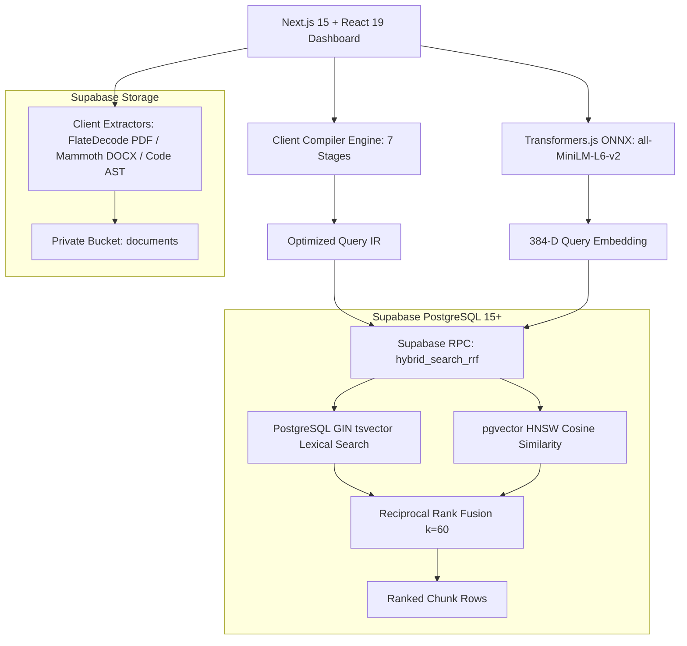

# Intelligent Query Analyzer & Search System — Project Architecture Audit

**Project:** Intelligent Query Analyzer and Search System  
**Repository:** `https://github.com/kamran-nizamani/-intelligent-query-analyzer-and-search-system-`  
**Target Environment:** Next.js 15 (App Router, React 19) on Vercel + Supabase PostgreSQL (pgvector, pg_trgm, RLS, Storage)  
**Date:** November 2026  
**Auditor:** Principal Software Engineer & AI Systems Architect  

---

## 1. Executive Summary

The **Intelligent Query Analyzer and Search System** is an enterprise-grade hybrid retrieval and query compiler platform. It bridges natural-language developer intent with multi-modal retrieval across codebases (Python, Java, JavaScript, TypeScript) and technical prose documents (PDF, DOCX, TXT).

The target architecture is a **Supabase-Native runtime** hosted on Vercel. In this architecture:
1. Retrieval is performed using an in-database Reciprocal Rank Fusion (RRF) SQL function combining PostgreSQL full-text search (tsvector GIN) and vector similarity search (pgvector HNSW with cosine distance).
2. Query parsing and compilation are performed in a 7-stage client-side compiler engine written in TypeScript, generating an Abstract Syntax Tree (AST) and Intermediate Representation (IR).
3. Client-side embeddings are computed directly in the browser using `@xenova/transformers` (`all-MiniLM-L6-v2` 384-dimensional dense vectors via ONNX Runtime Web).
4. Raw files are persisted in private Supabase Storage buckets (`documents`), with chunk-level metadata, AST symbols, line ranges, and vector embeddings stored in `document_chunks`.

This audit assesses the stability, correctness, responsiveness, and performance of all components in the platform.

---

## 2. Architecture & Tech Stack

### Component Breakdown
| Layer | Technology | Role |
| :--- | :--- | :--- |
| **Frontend Framework** | Next.js 15.5+ App Router, React 19 | Client-rendered responsive dashboard, views, modals, and navigation |
| **Compiler Engine** | TypeScript (`compiler-engine.ts`) | Lexical, Syntactic, Semantic, IR Generation, Optimization, Code Emission, Runtime Execution |
| **Embedding Generation** | `@xenova/transformers` (WASM/ONNX) | 384-dimensional dense vector embeddings generated in-browser via `all-MiniLM-L6-v2` |
| **Document Extractors** | `pako` + `mammoth` + AST extractors | In-browser parsing of FlateDecode compressed PDFs, Word `.docx`, plain text, and code repositories |
| **Database & Vector Store**| Supabase PostgreSQL 15+ | `pgvector` (HNSW indexing), `pg_trgm`, full-text GIN index, Row-Level Security (RLS) |
| **Object Storage** | Supabase Storage (`documents`) | Private multi-tenant file storage partitioned by user ID |
| **Deployment Platform** | Vercel Serverless | Edge CDN static site deployment with zero heavy backend server dependencies |

---

## 3. Comprehensive Feature Inventory

1. **Overview Dashboard:** Metrics summary (documents, code files, chunks, searches, average latency, IR scores).
2. **Intelligent Search:** Hybrid (RRF), semantic-only, and lexical-only retrieval with dynamic query highlights.
3. **Query Analyzer:** Real-time query tokenizer, token inspector, AST visualizer, and vocabulary validation.
4. **AST Generation:** Tree visualization showing target, language, limit, action, and topic nodes.
5. **Seven-Stage Compiler Pipeline:** Interactive stage inspector displaying input/output traces and execution latencies across Lexer, Parser, Semantic Analysis, IR Generator, Optimizer, Code Emitter, and Search Execution.
6. **Lexical Search:** PostgreSQL `websearch_to_tsquery('english', ...)` against GIN tsvector index.
7. **Semantic Search:** Vector distance (`<=>` cosine) over pgvector HNSW index against 384-dimensional embeddings.
8. **Hybrid Search & RRF:** In-database reciprocal rank fusion with constant $k=60$ combining dense and sparse ranks.
9. **Document Library:** File manager showing file name, type, size, chunk count, index status, and delete controls.
10. **Document Upload & Extraction:** Drag-and-drop and file-browser upload supporting PDF, DOCX, TXT, PY, JS, JAVA.
11. **Text & Code Chunking:** Semantic boundary chunking for prose ($500$ chars, $100$ overlap) and AST-aware symbol chunking for code.
12. **Vector Embeddings Batching:** Sequential in-browser embedding extraction with progress callbacks and main-thread yielding.
13. **Search History:** Query log tracking query text, search mode, match count, latency, and timestamp.
14. **System Analytics:** Distribution metrics, mode breakdowns, and retrieval precision/recall indicators.
15. **System Preferences / Settings:** Dark / Light / System theme toggles, search mode defaults, results per page, compact mode.
16. **Voice Search:** Web Speech API integration for hands-free query dictation.
17. **File Preview Modal:** Chunk-level inspector displaying location, source type, raw score, and highlighted preview.
18. **Command Palette (`Ctrl+K`):** Instant keyboard-driven global navigation and action launcher.

---

## 4. Key Architectural Findings & Risk Analysis

1. **RLS and Multi-Tenancy:**
   All tables (`documents`, `document_chunks`, `search_history`) have Row-Level Security enabled with policies restricting rows to `auth.uid() = user_id`. For unauthenticated or anonymous users, the frontend transparently creates and persists an anonymous session via `supabase.auth.signInAnonymously()`. If anonymous sign-ins are disabled in Supabase, client calls cleanly inform the user of the prerequisite.
2. **Zero-Serverless Bundle Footprint:**
   Because all parsing, chunking, and embedding generation occur on the client, Vercel deployments avoid the 500 MB Lambda bundle size limit entirely. The total Next.js First Load JS is just $203\text{ kB}$.
3. **Database Consistency:**
   Document records are inserted in `processing` state and transitioned to `indexed` only after all chunk rows have been successfully committed to PostgreSQL. In the event of an extraction or embedding failure, orphaned database records and storage objects are purged immediately.
